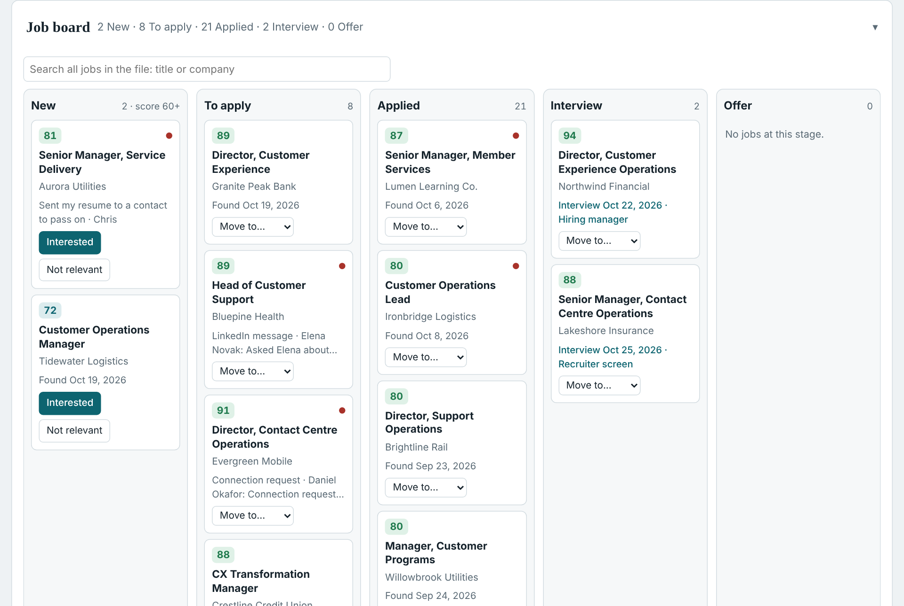
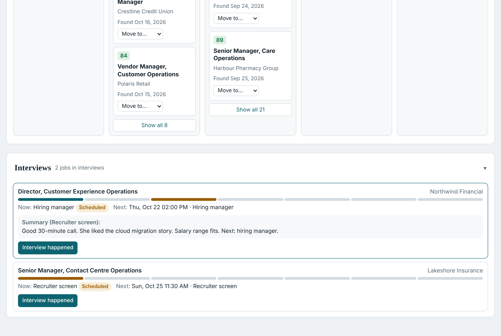
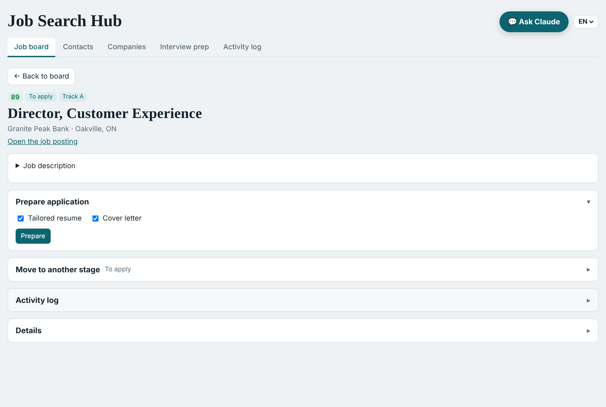
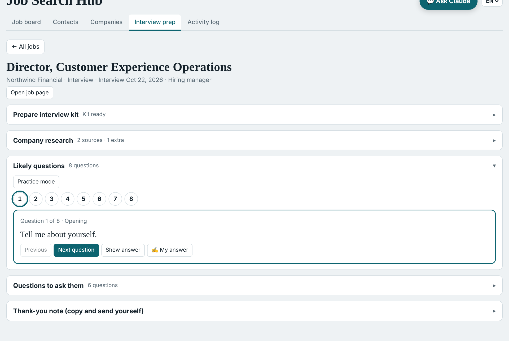
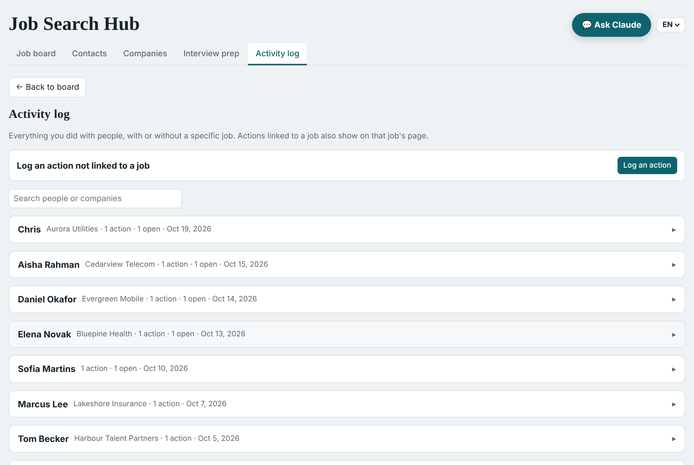
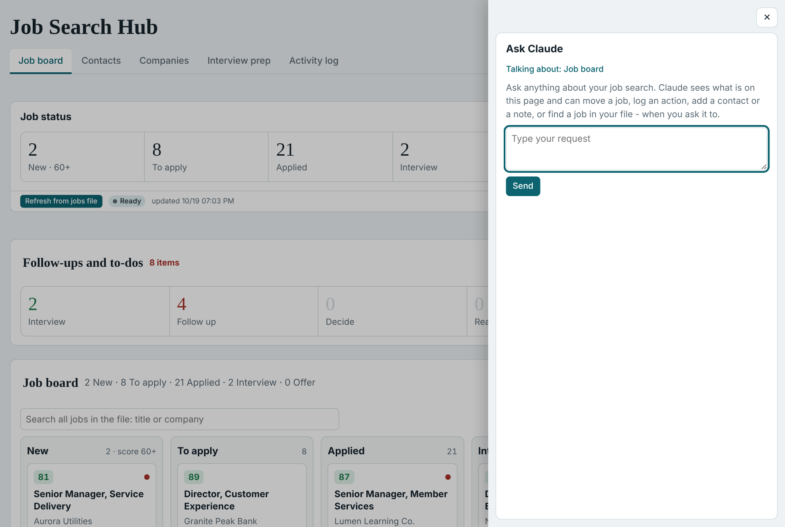

# Job Search Copilot: the complete guide

## 0. What this is

Job Search Copilot is a set of instructions and small scripts that turns Claude into a
job-search assistant. It reads job postings, scores each one against your real background,
writes a tailored resume and cover letter for the ones you choose, and prepares you for
interviews. In the full setup it also searches for new jobs every night and shows everything
on a personal dashboard.

It was built by a job seeker with no coding background, in conversation with Claude, and is
shared free.

> **The iron rule.** Job Search Copilot prepares; you decide and act. It never sends, submits,
> applies, posts or messages anyone for you. Every email, message and application is a draft
> that you review and send yourself. It also never invents facts: everything it writes comes
> from your own resume and your answers in the setup interview.


### What you get

| | Basic | Full |
|---|---|---|
| Score a job posting you paste (0-100, with the reasons) | ✓ | ✓ |
| Tailored resume and cover letter (Word files) | ✓ | ✓ |
| Interview preparation: company research, likely questions, practice with feedback | ✓ | ✓ |
| A spreadsheet that tracks every job and its status | ✓ | ✓ |
| Nightly search of company career sites and other sources you choose | | ✓ |
| Morning summary: new jobs scored, replies from employers spotted in your email | | ✓ |
| Personal dashboard: job board, follow-ups, interviews, contacts, activity log, chat | | ✓ |

## 1. Choose your level

Start with **Basic** if you are not sure. Everything you set up in Basic carries over to Full.

### What each level needs

| Requirement | Basic | Full |
|---|---|---|
| Claude plan | Any plan, including Free | A paid plan: Pro, Max, Team or Enterprise (the dashboard's saved data and the scheduled tasks are paid features) |
| Where you use Claude | Claude on the web, desktop or mobile | The Claude desktop app |
| Computer | Any | **Windows only** for now (the nightly scan uses Windows Task Scheduler). Mac support may come later. |
| Python | Not needed | Python 3.10 or newer, installed on your computer |
| Computer on at night | No | Yes. The scan runs on your computer, so it must be on, or able to wake, at the scan time |
| Email | Not needed | **Gmail only** for now, if you want job-alert emails as a source and employer replies spotted |
| Setting to turn on | Settings > Capabilities > "Code execution and file creation" | Same |

### The easy way: let Claude walk you through it
You don't have to follow this guide by hand. Give it to Claude and let Claude lead:

1. Do step 2.1 below yourself (turn on code execution). Claude cannot change your settings.
2. Start a new chat, attach this guide (`GUIDE.md` or the PDF), and paste:

```text
Read this guide and set up Job Search Copilot for me, step by step.
I want the <Basic / Full> setup. Do every step you can do yourself, and stop and tell me
exactly what to click whenever a step needs me.
```

Claude does most of the work: the setup interview, your profile files, the settings, the scan
and the dashboard. A few steps can only be done by you, and Claude will stop and ask:

| Step | Who does it |
|---|---|
| Turning on "Code execution and file creation" in Settings | You |
| Uploading the skill (the first time) | You |
| Installing Python (Full setup) | Claude guides you; you may need to click "Install" yourself |
| Connecting Gmail to Claude (Full setup) | You approve the connection |
| Approving the scheduled tasks when Claude creates them (Full setup) | You |
| Everything else: interview, files, settings, scan, dashboard, checks | Claude |

Each step in this guide is marked **[You]** or **[Claude]** so you always know whose turn it is.

### How long it takes
- **Basic:** about 20-30 minutes, most of it the setup interview.
- **Full:** about 1-2 hours the first time, including installing Python.

## 2. Basic setup

Each step has a prompt you can copy and paste into Claude. Where a step has no prompt, it is
something you do in Claude's settings.

### Step 2.1: Turn on code execution [You]
In Claude, open **Settings > Capabilities** and turn on **Code execution and file creation**.
Skills need it. (On Team and Enterprise plans, your organization's owner controls this setting
and whether you can upload skills.)

### Step 2.2: Install the skill [You]
1. Download `job-search-copilot-skill.zip` from this repository's main page (click the file,
   then the download button). This ZIP is the skill itself; don't unzip it.
2. In Claude, open **Customize > Skills**.
3. Click **+**, then **+ Create skill**, then **Upload a skill**.
4. Choose the ZIP file. "job-search-copilot" appears in your skills list; make sure it is on.


### Step 2.3: Run the setup interview [Claude asks, you answer]
Start a new chat and paste:

```text
Set up my job search. Start with the Basic setup.
```

Claude interviews you in plain conversation, a few questions at a time:
1. **Your resume.** Upload it (Word or PDF). If you don't have one, Claude interviews you about
   your career, one role at a time, and builds a basic two-page resume from your answers. Check
   every line: a resume built from an interview is only as good as the answers.
2. **Your facts and voice.** Anything missing from the resume, and how you like to sound.
3. **What you're looking for.** Your main target (Track A), an optional fallback (Track B), the
   job titles people use for them, where you want to work, and anything that rules a job out.
4. **How a job is scored.** The default is Role fit 40, Location 25, Seniority 20,
   Type & pay 15. Role fit gets the most weight on purpose: when location weighs more, jobs that
   are close by but not a real fit tend to score too high. Change it if you decide differently.

At the end Claude shows you a short summary of what it saved. You can change any of it later
in plain words, for example:

```text
Add "Operations Manager" to my target titles.
```
```text
Give location less weight and seniority more.
```

### Step 2.4: Score a job posting [Claude]
Paste the full posting text (or the link, if the page opens without a login):

```text
Score this job for me:
<paste the posting>
```

You get a score from 0 to 100, the breakdown (for example "Role 34/40, Location 25/25,
Seniority 14/20, Type 12/15 = 85") and one or two sentences on why. Anything that is an automatic
no for you (for example a language you don't speak) is flagged first.

### Step 2.5: Prepare an application [Claude]
```text
Prepare my resume and cover letter for this job.
```
Claude fills your own resume layout with the experience that fits this posting, uses the
posting's key words where they are true for you, and writes a cover letter in your voice. You
get two Word files. Read them, change what you want, and send them yourself.

### Step 2.6: Prepare for an interview [Claude]
```text
I have an interview at <company> for <job title> on <date>. Prepare me.
```
You get a short research brief on the company and the role, the questions they are likely to
ask with suggested answers built from your real experience, good questions to ask them, and a
thank-you note draft. Then practise:

```text
Let's practise. Ask me one question at a time and rate my answers.
```

### Step 2.7: Keep track [Claude]
Every job you score is saved in a spreadsheet (`pipeline/jobs.xlsx`), next to your profile files.
Where those files live matters:
- **Claude desktop app with a folder on your computer selected (recommended):** everything stays
  in that folder between chats.
- **Claude on the web:** files created in one chat are not there in the next one. At the end of a
  session, download the `profile` folder and `jobs.xlsx`, and upload them at the start of the next
  chat with "Here are my job search files, continue from them."

Tell Claude what happened and it updates the status:

```text
I applied to the <company> job today.
```
```text
What's waiting for a follow-up this week?
```

That's the Basic setup. When you want the nightly search and the dashboard, continue with
chapter 3, "Full setup".


## 3. Full setup

The Full setup adds three things on top of Basic: a **nightly scan** on your computer, a
**morning agent** that scores what the scan found and reads your Gmail for job alerts and
replies from employers, and your own **dashboard**. Do the Basic setup first.

Before you start, check the requirements in chapter 1: a paid Claude plan, the Claude desktop
app on **Windows**, Python, and a computer that is on (or can wake) at night. Gmail is needed only
for job-alert emails and spotting replies.

The easiest way through this chapter is to let Claude lead (see "The easy way" in chapter 1):

```text
Read GUIDE.md and do the Full setup with me, chapter 3, step by step.
Do every [Claude] step yourself and stop at every [You] step.
```

### Step 3.1: Install Python [You]
Download Python 3.10 or newer from python.org and run the installer. On the first screen,
tick **"Add python.exe to PATH"**. Claude can check that it worked.

### Step 3.2: Put the project on your computer [You, then Claude]
1. Download the repository as a ZIP (green **Code** button > **Download ZIP**) and unzip it to a
   folder you will keep, for example `Documents\job-search-copilot`.
2. In the Claude desktop app, start a new task and connect that folder.
3. Paste:

```text
Run install.bat in this folder and tell me when it's done.
```

Claude creates a private Python environment in the folder, installs what the scanners need,
and creates your files (profile, settings, the jobs spreadsheet). Nothing is installed outside
the folder except the browser the scanners use. (If your Basic setup lives in another folder,
ask Claude to copy your `profile` and `templates` folders and `jobs.xlsx` into this one.)

### Step 3.3: Choose where to search [Claude asks, you answer]
```text
Set up my search sources for the Full setup.
```
Claude goes through the sources with you and saves your choices in `profile/SETTINGS.json`:
- **Company career sites:** 10-40 employers you would like to work for. Claude finds each
  careers page and shows you the list. Most applicant-tracking systems (Greenhouse, Lever, Ashby,
  Workday, SuccessFactors) are read reliably; other sites are read on a best-effort basis.
- **Government of Canada Job Bank** (Canada only): which nights it runs. It is slower and, in our
  experience, brings fewer strong matches, so the default is twice a week (Monday and Thursday).
- **Job-alert emails (Gmail only for now):** set up alerts on job sites you already use, and
  Claude agrees with you on a Gmail search that finds them. Alert emails contain only a title and
  a link, so the system opens each link to read the full posting before it is scored.
- **Anything else:** see chapter 5, "Add a search source".

Then a test run:
```text
Run the scan once now and show me what it found.
```

### Step 3.4: Schedule the nightly scan [Claude, then You]
```text
Schedule the nightly scan at 1:00 AM.
```
Claude runs `scripts\install_nightly_scan.bat`, which creates a Windows Task Scheduler task.
It runs every night, and skips the nights you did not choose (`schedule.scan_nights` in your
settings). If your computer sleeps at night: open **Task Scheduler**, find
**"Job Search Copilot nightly scan"**, open **Properties > Conditions** and tick
**"Wake the computer to run this task"** [You].

Each scan writes `output\logs\nightly_scan.log`, and `output\logs\scan_status.json` says whether
it finished.

### Step 3.5: Connect Gmail [You]
Needed for job-alert emails and for spotting replies from employers. In Claude, open
**Settings > Connectors** (the menu name can differ slightly between app versions), connect
**Gmail** and approve. The agents only read your mail. They never send, reply, label or delete.

### Step 3.6: Create your dashboard [Claude]
```text
Create my Job Search Hub dashboard from dashboard/job-search-hub.template.html.
```
Claude makes your own copy of the dashboard page, fills in your folder path, and publishes it as
a **private** page in your Claude account (only you can open it). It needs these page
permissions, which Claude sets: saved data (db), asking Claude (sample, used by the chat and by
answer rating), and starting your sync task (the "Claude Code Remote" connection, tool
`update_trigger`).

### Step 3.7: Create the two scheduled tasks [Claude, then You]
```text
Create the sync task and the morning task from the agents folder, and connect them to my dashboard.
```
- **Sync task:** has no clock of its own. The dashboard starts it whenever you press a button
  (Refresh, Prepare, a card you moved, an interview kit). It moves jobs in your spreadsheet,
  prepares documents, builds interview kits and refreshes the board.
- **Morning task:** every weekday morning, about an hour after the scan. It adds jobs from alert
  emails, fills in descriptions, scores everything new, checks Gmail for replies, refreshes the
  board and writes the morning summary.

Claude fills in your dashboard address, folder and time zone, creates both tasks, and puts the
sync task's ID into the dashboard. **You approve each task** when Claude asks.

### Step 3.8: First run [You and Claude]
Open the dashboard and press **Refresh from jobs file**. Within a few minutes the status changes
to "Agent is working" and then "Up to date", and the board fills in. If it stays on "Waiting",
your computer may be asleep or the desktop app closed.

## 4. Using the dashboard

### Home page


- **Job status:** how many jobs are at each stage. "New · 60+" counts only new jobs that scored
  at or above your board threshold (default 60). The small bar underneath has the
  **Refresh from jobs file** button and shows when the board was last updated.
- **Follow-ups and to-dos:** tiles for what needs you now: upcoming interviews, people to follow
  up with, replies waiting for your decision, documents ready to send, and applications with no
  answer after 10 days. Click a tile to see the list.
- **Job board:** one column per stage (New, To apply, Applied, Interview, Offer). Each card shows
  the score, the job, the company and the latest note. Drag a card or use its menu to move it.
  Marking a job "Not relevant" asks why; the reason is saved and helps you calibrate scoring.
  The search box finds any job in your file, including archived ones, and can bring one back.



- **Interviews:** every job in the interview stage, with a progress bar of the rounds (screen,
  video, hiring manager, panel, assignment, final, references), the current round and the next
  date and time. **Interview happened** marks the round as done and asks for a short summary,
  which then shows under the job.



### A job's page
Click a job's title. In order: the job description, **Prepare application** (tick resume and/or
cover letter and press Prepare; the Word files appear in `output\applications\<Company>_<Role>\`),
interview preparation and interview rounds (for jobs you applied to), **Move to another stage**,
application details, the job's **Activity log**, and **Details** (score note, dates, contact).



### Interview prep
Lists the jobs in the interview stage. Each has a kit: company research with sources, likely
questions with suggested answers built from your real experience, questions to ask them, and a
thank-you note to copy. In **Practice mode** you answer one question at a time (typing, or
dictating with Windows + H) and Claude rates your answer.



### Activity log, contacts and companies
- **Activity log:** everything you did with people (emails, calls, messages, referrals), with a
  reminder date. Each entry stays open as a thread until you close it with how it ended.
- **Contacts:** the people in your network, with notes.
- **Companies:** the employers in your nightly scan. Add, pause or remove them here.



### Ask Claude
The **Ask Claude** button opens a chat on every page. It knows what is on the page and can
search your jobs, move a job, log an action, or add a contact, but only when you ask. It
drafts; it never sends anything.



The dashboard works on a phone too, and has an **EN / HE** language switch.

## 5. Customizing

Everything is changed by asking Claude in plain words. Claude updates your settings and tells
you when the change takes effect.

| You want to... | Say |
|---|---|
| Add a job title | "Add Operations Manager to my target titles." |
| Change where you search | "Add Hamilton with a 30 km radius." / "Stop searching Toronto." |
| Change how jobs are scored | "Give location less weight and seniority more." |
| Raise or lower the board threshold | "Only show new jobs from 70 up." |
| Set aside more irrelevant titles | "Never show me nursing or driver jobs." |
| Add a rule for every document | "Always mention my PMP certification." |
| Watch an employer | "Add Acme's careers page to my scan." |
| Change scan nights | "Scan Sunday to Thursday nights only." |

### Add a search source
```text
Add <site name or link> to my search.
```
For a company careers page, Claude adds it to your company list and tests it. For any other site
(a job board, an association's job page, an RSS feed), Claude first reminds you: **you are
responsible for checking that the site's terms of use allow automated reading; many large job
sites do not.** After you confirm, Claude writes a small reader for that site, tests it once,
and adds it to your settings.

### Calibrate the scores after a week
After about a week of scans, look at the jobs you marked "Not relevant" and the reasons you gave,
and ask:
```text
Look at the jobs I marked not relevant this week and suggest changes to my scoring.
```

## 6. Limits and safety

- **The iron rule:** the system prepares; you decide and act. It never sends, submits, applies,
  posts, connects or messages anyone for you.
- **Your data stays yours:** your profile, documents and job list live in your own folder and
  your own Claude account. The dashboard is private unless you share it. There is no server.
- **No LinkedIn scanning:** this project does not read LinkedIn automatically and does not include
  any code for it. If you add a site yourself, checking its terms of use is your responsibility.
- **Current limits:** the Full setup runs on Windows only; Gmail is the only email provider for job
  alerts and replies; the dashboard and the scheduled tasks need a paid Claude plan; the scan
  only runs while your computer is on or able to wake.
- **Scores are a guide, not a verdict.** Read the postings that matter to you.

## 7. Troubleshooting

| What you see | What to do |
|---|---|
| Dashboard stays on "Waiting for the agent" | The computer is asleep or the Claude desktop app is closed. Wake it, open the app, press Refresh again. |
| "Did not finish in time" | Same as above. Your request stays in the queue and runs on the next start. |
| A move "was not saved" because the file is locked | `jobs.xlsx` is open in Excel. Close it; the move is retried automatically. |
| The jobs file was damaged | It is repaired automatically from `pipeline\backups\jobs.last-good.xlsx`; the damaged copy is kept in the same folder. If no backup exists, restore `jobs.xlsx` from your cloud drive's version history. |
| No new jobs in the morning | Check `output\logs\nightly_scan.log`. "SKIPPED" means it was not a scan night; "NO INTERNET" means the computer had no connection. |
| A company page finds nothing | Some career sites cannot be read automatically. Ask Claude to check that company's page and suggest another way. |
| Many jobs "without a description" | The posting page could not be read. Paste the description into the chat and ask Claude to score it. |

## 8. Feedback

Found a problem, or have an idea? Open an issue on this project's GitHub page, or send a short
note through the GitHub discussion for the project. Please don't include personal data.
