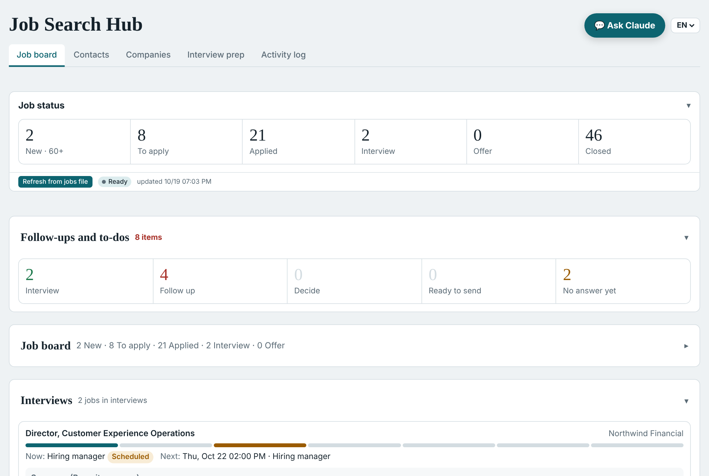

# Job Search Copilot

Turn Claude into a job-search assistant: it scores job postings against your real background,
writes a tailored resume and cover letter for the ones you choose, and prepares you for
interviews. In the full setup it also searches for new jobs every night and shows everything
on a personal dashboard.

Built by a job seeker with no coding background, in conversation with Claude. Free to use.

> **The iron rule.** It prepares; you decide and act. It never sends, submits, applies, posts or
> messages anyone for you. Every application and message is a draft you review and send
> yourself. It never invents facts about you.

## Two levels

| | Basic | Full |
|---|---|---|
| Score postings, tailored resume and cover letter, interview prep, job tracker | ✓ | ✓ |
| Nightly job search, morning summary, personal dashboard | | ✓ |
| Claude plan | Any, including Free | Paid (Pro or higher) |
| Computer | Any | **Windows only**, Python, on at night |
| Email | Not needed | **Gmail only** |

## Get started

1. In Claude, turn on **Settings > Capabilities > Code execution and file creation**.
2. Download [`job-search-copilot-skill.zip`](job-search-copilot-skill.zip) and upload it in
   **Customize > Skills > + > Create skill > Upload a skill**.
3. Start a new chat, attach [`GUIDE.md`](GUIDE.md) (or [the PDF](Job-Search-Copilot-Guide.pdf)),
   and say: *"Read this guide and set up Job Search Copilot for me, step by step."*

Claude leads from there and stops whenever a step needs you. The full guide is in
[GUIDE.md](GUIDE.md).

## What's in this repository

| Path | What it is |
|---|---|
| `GUIDE.md`, `Job-Search-Copilot-Guide.pdf` | The complete guide |
| `job-search-copilot-skill.zip` | The skill to upload to Claude (built from the files below) |
| `SKILL.md` | The skill's instructions |
| `profile/` | Blank templates the setup interview fills in |
| `scripts/` | The scan, scoring queue, tracker and document scripts (Python) |
| `agents/` | Prompts for the two scheduled tasks (Full setup) |
| `dashboard/` | The dashboard page template (Full setup) |
| `templates/examples/` | Example resume and cover letter for a made-up candidate |
| `docs/images/` | Screenshots (demo data) |

## Search sources

Built in: company career sites you choose, the Government of Canada Job Bank, and job-alert
emails in Gmail. You can ask Claude to add any other site; you are responsible for checking
that the site's terms of use allow automated reading.

## Privacy

Your profile, resume, job list and documents stay in your own folder and in your own Claude
account. Nothing is sent to the author of this project. The `.gitignore` keeps personal files
out of any copy you publish.

## License

MIT. See [LICENSE](LICENSE).
